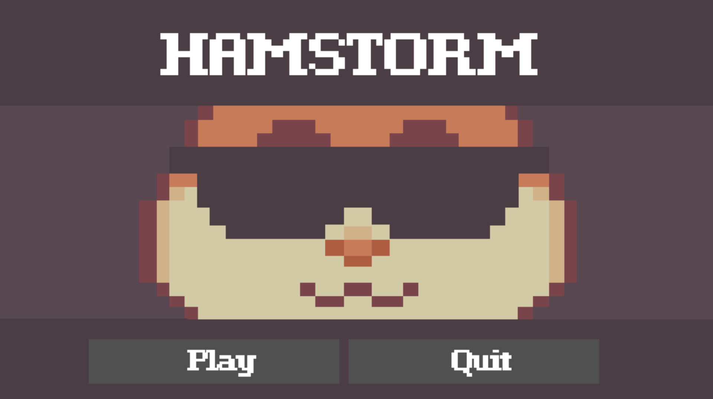
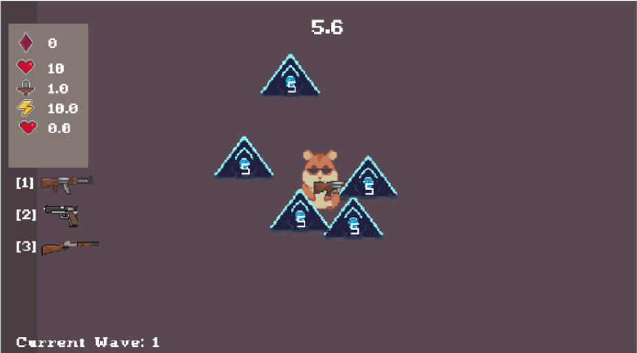

  
  # 🎮🐹 Hamstorm
  
  

 

 Inspirado no clássico Brotato, Hamstorm é um jogo top-down arena shooter com elementos roguelike (jogo de tiro com área limitada; fases cronometradas; se morrer, recomeça). 
  

 Jogador controla um hamster armado e precisa sobreviver a ondas de inimigos até enfrentar o boss final. 
  

<ul>
  <li>Linguagem e Biblioteca: C++ com Raylib</li>
  <li>Ambiente de Desenvolvimento: Visual Studio Code (VS Code)</li>
  <li>Arte e Elementos Visuais: Criados no Aseprite e recursos do Itch.io</li>
  <li>Efeitos Sonoros e Musicas: Pixabay</li>
</ul>

 

colocar o link do jogo aqui
